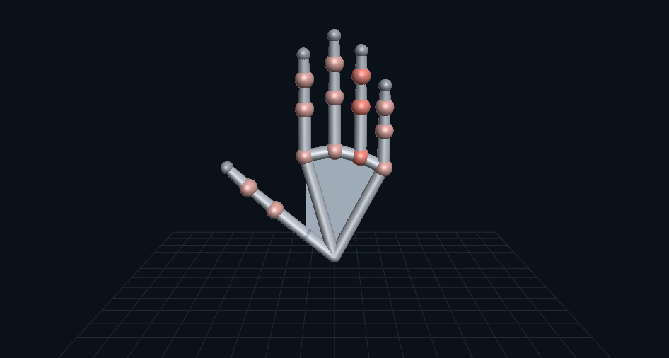

# ManuMetria

**Avaliação cinemática da mão por visão computacional**

O ManuMetria mede a amplitude de movimento das articulações dos dedos usando só a webcam do computador,
sem marcadores nem equipamento extra. Enquanto o paciente abre e fecha a mão, o sistema mostra as medidas
ao vivo, guarda cada avaliação na ficha do paciente e acompanha a evolução ao longo do tratamento.

## Para quem é

- **Fisioterapeutas, terapeutas ocupacionais e terapeutas da mão** que querem registrar e acompanhar a
  amplitude de movimento dos dedos.
- **Pesquisadores** em reabilitação e biomecânica da mão, que precisam de dados padronizados e
  exportáveis.
- **Instituições e possíveis licenciados** que avaliam o software.

## O que o sistema faz

- **Cadastro e ficha de pacientes**: dados clínicos, situação (em tratamento ou alta) e lista de
  avaliações.
- **Avaliação ao vivo** com a imagem da câmera e uma **mão 3D colorida**, em que cada articulação mostra a
  situação do seu dedo.
- **Medidas por articulação e por dedo**: flexão, amplitude total, % do normal, repetições, velocidade,
  independência dos dedos e outras.
- **Evolução e comparação entre avaliações**, com o **erro de medida** estimado pelo reteste, para saber se
  uma mudança é real.
- **Relatório em PDF**, com o logotipo da instituição.
- **Exportação** em planilha para o Excel e em **dataset de pesquisa anonimizado** (pseudonimizado).
- **Modo simulação**, com uma mão simulada, para conhecer o sistema sem câmera.

## Requisitos

- Windows 10 ou 11, 64 bits.
- Uma webcam comum (sem câmera, só o modo simulação).
- Cerca de 1 GB de espaço livre.
- Placa de vídeo com OpenGL 2.0 ou superior (qualquer computador recente).
- Internet **só durante a instalação**. Depois, o sistema funciona sem internet.

## Instalação

1. **Baixe o ManuMetria** e descompacte a pasta onde quiser (por exemplo, em Documentos).
2. **Instale o Python 3.11**, se o computador ainda não tiver: baixe em
   <https://www.python.org/downloads/release/python-3119/> o instalador do Windows de 64 bits e, na
   primeira tela, marque **Add python.exe to PATH**.
3. **Dê dois cliques em `Instalar sistema.bat`.** Ele prepara tudo sozinho e cria três pacientes
   fictícios de demonstração. Leva de 2 a 10 minutos e termina com a mensagem
   `=== Instalacao concluida ===`.
4. **Para abrir o ManuMetria, dê dois cliques em `Abrir sistema.bat`** (com a webcam) ou em
   `Abrir simulacao.bat` (com a mão simulada). Se quiser, crie um atalho do `Abrir sistema.bat` na área de
   trabalho.

Passo a passo detalhado e solução de problemas: [INSTALACAO.md](INSTALACAO.md).

## Como usar

1. Na tela **Pacientes**, clique em **Novo paciente** ou abra a ficha de um paciente (dois cliques).
2. Na ficha, clique em **Nova avaliação**.
3. Posicione a mão do paciente com a **palma voltada para a câmera**, a cerca de 50 cm, com boa luz.
4. **Calibração**: o sistema pede a mão aberta e parada por 2 segundos.
5. Peça o movimento (por exemplo, abrir e fechar a mão o máximo possível, algumas vezes). Os cartões dos
   dedos contam os movimentos ao vivo; clique num dedo para ver os detalhes. Os botões **Câmera** e
   **Modelo 3D** trocam a imagem principal; na mão 3D, passe o mouse sobre uma articulação para ver os
   valores.
6. Clique em **Encerrar sessão**. No relatório, escreva as observações, use **Fazer reteste** quando quiser
   estimar o erro de medida e clique em **Salvar na ficha**.
7. Clique em **Gerar PDF** para o relatório (ou **Exportar CSV** para os números).
8. Na ficha, acompanhe a evolução no gráfico e no mapa, e use **Comparar** para ver duas avaliações lado a
   lado.

A tela **Ajuda** explica cada medida, e passar o mouse sobre um número também mostra a explicação. Para
conhecer o sistema, abra a ficha dos pacientes fictícios **João Pereira (fictício)** ou
**Maria Souza (fictícia)**.

## Medidas

- **Flexão**: quanto cada articulação do dedo dobra, em graus. Valores negativos indicam hiperextensão.
- **TAM** (*total active motion*, movimento ativo total): a soma do movimento das articulações de um dedo,
  descontando o que falta para esticar.
- **% do normal**: o TAM do dedo comparado com o de uma mão sem limitação. Na tela e na mão 3D: vermelho
  abaixo de 50%, amarelo de 50% até abaixo de 75% e verde a partir de 75%.
- **Repetições**: quantas vezes o paciente fechou e abriu o dedo, classificadas em movimento, parcial e
  completa conforme a amplitude.
- **Velocidade**: rapidez ao fechar e ao abrir o dedo, em graus por segundo.
- **Independência**: quanto o dedo consegue se mover sem arrastar os outros junto.

O sistema também calcula o déficit de extensão, o arco funcional, o escore de Strickland, a distância
polpa–palma, a suavidade do movimento, sinais de fadiga, o tremor e a confiabilidade de cada avaliação.

Como cada medida é calculada (goniometria ISB, filtros, referências clínicas e verificação dos cálculos):
[docs/METODOLOGIA.md](docs/METODOLOGIA.md). Mudanças de método entre versões: [CHANGELOG.md](CHANGELOG.md).

## Dados e privacidade

- **Os dados ficam só neste computador**, na pasta `dados_locais/`: pacientes, avaliações e os pontos da
  mão de cada quadro. O sistema não grava vídeo e não envia nada para a internet.
- **Cópia de segurança**: antes de cada atualização, o sistema copia o banco para
  `dados_locais/copias_de_seguranca/`. Para se proteger de perda do computador, copie a pasta
  `dados_locais/` regularmente para um local seguro, com o sistema fechado.
- **Exportações** (botão **Exportar dados**, na tela Pacientes):
  - **Planilha para o Excel**: identificada (nome, condição e datas), para uso clínico;
  - **Dataset para pesquisa**: pseudonimizado, sem nome nem data de nascimento, com datas relativas e
    dicionário de dados.
- **LGPD**: dado de saúde é dado pessoal sensível, e os pontos 3D da mão são dado biométrico. No uso com
  pacientes reais, proteja o computador (senha, criptografia do disco) e obtenha o consentimento dos
  pacientes.
- **Pesquisa**: o uso dos dados em pesquisa exige aprovação do Comitê de Ética em Pesquisa (CEP) e o
  consentimento dos participantes; compartilhe o dataset só com acesso controlado.

## Limitações e aviso

- O ManuMetria é **software de pesquisa**. **Não é dispositivo médico registrado na ANVISA.**
- As medidas são estimativas feitas por uma câmera comum. A precisão depende da **câmera**, da **luz** e
  da **posição da mão**: a mão de lado, longe demais ou com dedos escondidos atrás de outros piora a medida.
- O sistema ainda não foi comparado com o goniômetro manual. Use o reteste para saber quanto a medida varia
  no seu ambiente.
- Os resumos e as interpretações são apoio à decisão. O ManuMetria **não substitui a avaliação
  profissional**.

## Licença

A definir. Bibliotecas de terceiros e as suas licenças: [AVISOS_TERCEIROS.md](AVISOS_TERCEIROS.md).

## Autoria

**Leandro Fidelis**, Universidade Federal de Ciências da Saúde de Porto Alegre (UFCSPA), laboratório NERV.

Para quem for manter o código: [DESENVOLVIMENTO.md](DESENVOLVIMENTO.md).
