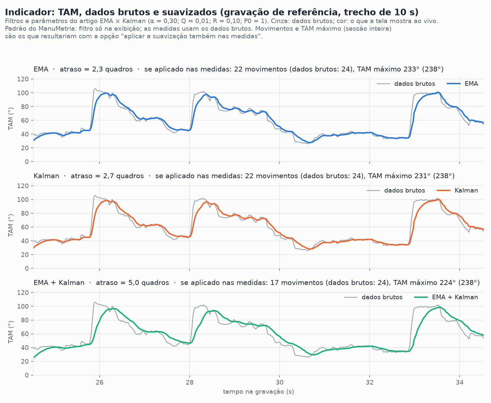

# Metodologia do ManuMetria

Como o ManuMetria transforma a imagem da webcam em medidas: os ângulos, o tratamento do sinal, a definição
de cada medida, como os cálculos são verificados e as referências científicas. O uso do sistema está no
[README](../README.md); as mudanças de método entre versões, no [CHANGELOG](../CHANGELOG.md).

Termo usado: **dados brutos** = ângulos calculados quadro a quadro, sem filtro de suavização.

## 1. Da imagem aos ângulos

- A câmera encontra **21 pontos da mão** em cada quadro (MediaPipe, Google). O sistema não grava vídeo:
  guarda só esses pontos.
- Os **ângulos** de cada articulação (MCP, PIP e DIP nos dedos longos; MCP e IP no polegar) são medidos por
  **decomposição por osso**, recomendação da International Society of Biomechanics (ISB; Wu et al., 2005):
  cada osso tem eixos próprios, e a abdução (dedo desviado para o lado) fica separada da flexão. Flexão é
  positiva; hiperextensão, negativa.
- Na MCP, a linha do punho até a base do dedo faz o papel do metacarpo (o MediaPipe não marca a base do
  metacarpo).
- O lado da mão (direita ou esquerda) é fixado na calibração; a mão esquerda dá os mesmos ângulos que a
  direita espelhada.

## 2. Tratamento do sinal

O que o sistema faz com os ângulos de cada quadro, nesta ordem:

- **Descarta** quadros com ângulos fisicamente impossíveis (fora de −60° a 130°) e quadros com a mão de
  lado (palma a mais de 60° da frente), como se fossem falhas de detecção.
- Em falhas curtas de detecção (até 0,4 s), **mantém a última pose** e não atualiza as medidas.
- **Suaviza a exibição ao vivo** com o filtro escolhido em **Configurações > Suavização do sinal**. Cada
  articulação tem um filtro independente:

  | Modo | Equações | Parâmetros | Atraso médio |
  |---|---|---|---|
  | Desligada | dados brutos | — | 0 |
  | EMA | y = α·z + (1 − α)·y anterior | α = 0,30 | ≈ 2,3 quadros |
  | Kalman | posição constante: P⁻ = P + Q; K = P⁻/(P⁻ + R); x = x + K·(z − x); P = (1 − K)·P⁻ | Q = 0,01; R = 0,10; P₀ = 1; x₀ = 1º valor | ≈ 2,7 quadros (K estável ≈ 0,27) |
  | **EMA + Kalman** (padrão) | EMA e depois Kalman | os dois acima | ≈ 5,0 quadros (≈ 0,17 s a 30 quadros/s) |

### Por que as medidas usam os dados brutos

**Por padrão, o filtro vale só para a exibição ao vivo** (valor "Agora" das articulações e
gráfico "TAM nos últimos 20 s"). **Todas as medidas da sessão usam os dados brutos** (máximos, mínimos,
déficits, TAM ativo, % do normal, repetições, velocidades, SPARC, independência, PDF e CSV), iguais às do
modo Desligada. Motivo: a suavização **achata os picos**. Na gravação de referência (mão saudável),
aplicando EMA + Kalman também nas medidas:

| Dedo | Repetições | TAM ativo (% do normal) | Velocidade de pico (°/s) |
|---|---|---|---|
| Polegar | 32 → 21 | 65 → 61 | 332 → 111 (−66%) |
| Indicador | 23 → 19 | 98 → 88 | 246 → 182 (−26%) |
| Médio | 31 → 22 | 104 → 94 | 237 → 165 (−30%) |
| Anelar | 27 → 21 | 107 → 98 | 278 → 172 (−38%) |
| Mínimo | 25 → 16 | 108 → 99 | 372 → 266 (−29%) |

(dados brutos → suavizado nas medidas). A flexão máxima da MCP do indicador cai de 81,5° para 71,1°, no
limite do arco funcional (71°).

### Suavização também nas medidas (opcional)

Com **"Aplicar a suavização também nas medidas"** marcada em Configurações, o filtro entra antes do
contador de repetições e de todas as medidas. As medidas ficam mais estáveis, mas com picos menores, e
deixam de ser comparáveis com as avaliações feitas sem essa opção.

- O filtro só usa a sequência de quadros (não o relógio): recalcular a partir dos pontos gravados dá o
  mesmo resultado da avaliação ao vivo.
- Quadros descartados ou "segurando" não entram no filtro; perda longa da mão, mão de lado, pausa,
  recalibração e nova avaliação o zeram.
- Calibração, tremor, abertura dos dedos e polpa–palma usam sempre os dados brutos.
- Cada avaliação registra o filtro e se ele entrou nas medidas (PDF, CSV e dicionário de dados), e
  **Recalcular avaliações** usa sempre esse registro (sem registro: Desligada; sem a indicação de medidas:
  dados brutos).

## 3. Repetições e velocidades

- O **contador de repetições** decide QUANDO há uma repetição sobre a média dos últimos 8 quadros do TAM,
  com histerese igual à sensibilidade medida na calibração (3 × o tremor com a mão parada, nos dados
  brutos, entre 2° e 30°; 5° sem calibração).
- A amplitude (pico menos vale), a classificação movimento / parcial / completa, o TAM no pico, a excursão
  de cada articulação e as velocidades médias saem dos **dados brutos**. Parcial = pelo menos 25% do TAM
  normal; completa = pelo menos 75%.
- O início e o fim de cada subida e descida seguem um critério do sistema (sem fonte na literatura): último
  instante a até meia sensibilidade do vale, primeiro instante a até meia sensibilidade do pico. Assim,
  pausas não entram no tempo.
- A **velocidade de pico** usa uma derivada por mínimos quadrados em 5 pontos (Savitzky–Golay de 1ª ordem)
  do TAM de cada repetição, em grade uniforme de 30 Hz. A **suavidade** (SPARC; Balasubramanian et al.,
  2015) usa a norma das velocidades das articulações do dedo, com limiar de 0,05 e corte de 10 Hz. As duas
  só entram em repetições de pelo menos 15°.

## 4. Definição das medidas

| Medida | Definição |
|---|---|
| Flexão de cada articulação | ângulo atual, mínimo e máximo da sessão; arco = máximo − mínimo |
| Déficit de extensão | maior valor entre 0 e a menor flexão (a hiperextensão conta 0), como na fórmula do TAM da ASSH |
| TAM | soma das flexões máximas das articulações do dedo |
| TAM ativo | soma das flexões máximas − soma dos déficits de extensão |
| % do normal | TAM ativo ÷ normal (260° nos dedos longos, 140° no polegar); vermelho abaixo de 50%, amarelo de 50% até abaixo de 75%, verde a partir de 75% (faixas no estilo da ASSH) |
| Arco funcional | quanto do arco funcional de cada articulação (Bain et al., 2015: MCP 19–71°, PIP 23–87°, DIP 10–64°) o paciente cobre |
| Escore de Strickland | (PIP + DIP − déficits) ÷ 175°, com as classes de Strickland e Glogovac (1980) |
| Distância polpa–palma | distância da ponta do dedo até a linha da palma, em cm |
| Repetições | movimento / parcial / completa (seção 3) |
| Velocidades | média de flexão, média de extensão e de pico, em °/s (seção 3) |
| Suavidade (SPARC) | mais perto de zero = mais suave (seção 3) |
| Ciclo, cadência e regularidade | tempo entre repetições, repetições por minuto e variação do ciclo |
| Fadiga e consistência do esforço | tendência da amplitude e da velocidade ao longo da sessão; amplitude do fim × início; picos das repetições mais fortes |
| Independência dos dedos | quanto o dedo se move sem arrastar os outros (100% = sozinho) |
| Contribuição de cada articulação | divisão do movimento do dedo entre MCP, PIP e DIP |
| Abertura dos dedos e do polegar | ângulo entre dedos vizinhos (com a MCP até 30°) e abertura do polegar |
| Tremor | frequência, intensidade (RMS) e pico da oscilação dos pontos, em janelas de 2 s, faixa de 3 a 12 Hz |
| Confiabilidade da avaliação | quadros válidos, quadros por segundo, luz, vista da mão, duração e número de repetições |
| Erro de medida (MDC) | MDC95 = 1,96 × desvio padrão das diferenças teste–reteste (= 1,96 × √2 × EPM), com pelo menos 10 pares |
| Mudança real, tendência e platô | mudança maior que o MDC; inclinação por semana (4 avaliações ou mais); platô nas 3 últimas avaliações |

**Horário e duração.** O horário de cada avaliação marca o início da sessão (quando a preparação começa,
antes da calibração); a duração conta só a medição, sem a preparação, a calibração, as recalibrações e as
pausas.

**Interpretação.** O resumo da ficha, a mudança real e o platô são calculados por regras explícitas, com
"sugestivo de": apoio à decisão, não diagnóstico.

## 5. Rastreabilidade

Cada avaliação guarda a versão do ManuMetria que calculou as medidas, o método dos ângulos, o filtro usado
e o fuso do horário. Cada avaliação recebe um código fixo no paciente (A01, A02...), nunca renumerado:
apagar uma avaliação deixa um buraco na numeração. **Recalcular avaliações** passa os pontos gravados pelo
cálculo em uso, mostra o que muda antes de gravar, guarda o resultado anterior na própria avaliação e
registra a versão atual. O relatório, o PDF, o CSV do relatório e a planilha saem do mesmo resultado salvo.

## 6. Dados exportados para pesquisa

**Exportar dados** (tela Pacientes) oferece duas saídas:

| | Planilha para o Excel | Dataset para pesquisa |
|---|---|---|
| Uso | clínico, **identificada** (nome, condição, datas) | pesquisa, **pseudonimizado** (`id_pesquisa`, sem nome nem data de nascimento) |
| Arquivos | `avaliacoes_por_dedo.csv` + dicionário | `pacientes.csv`, `avaliacoes.csv`, `dedos.csv`, `repeticoes.csv`, `quadros/<id_avaliacao>.csv.gz`, `dicionario_de_dados.csv`, `LEIA-ME.md`, `checksums.sha256` |
| Formato | `;`, vírgula decimal, UTF-8 com BOM (abre direto no Excel) | `,`, ponto decimal, UTF-8 sem BOM, faltante = vazio, sim/não = 1/0, ISO 8601 (pandas, R) |
| Granularidade | avaliação × dedo | paciente, avaliação, avaliação × etapa (avaliação/reteste) × dedo, repetição, quadro |

No dataset:

- `quadros` traz, por quadro, o tempo, os 21 pontos 3D, a mão e a confiança do MediaPipe, a fase, o estado
  do estabilizador, os descartes, a vista e os ângulos de cada articulação nos dados brutos e suavizados;
  com ele dá para refazer as medidas de `dedos.csv` sem o programa;
- as medidas das avaliações com pontos são **recalculadas dos pontos** com o cálculo da versão que exporta
  (o mesmo da tela); `confere_com_salvo` e `maior_diferenca_salvo_graus` dizem se batem com o resultado
  salvo. Avaliações sem pontos saem com as medidas salvas;
- por padrão as **datas são relativas** (dias desde a primeira avaliação do paciente) e a idade é calculada
  na exportação (a data de nascimento não sai); opções: datas exatas e a condição/diagnóstico (texto
  livre). As observações nunca saem; as coordenadas 2D da imagem ficam fora;
- as coordenadas 3D da mão são **dado biométrico** (LGPD, art. 5º, II): o dataset só deve ser compartilhado
  com acesso controlado, aprovação do Comitê de Ética em Pesquisa (CEP) e consentimento dos participantes.
  O pseudônimo não pode ser revertido sem o banco local. O `LEIA-ME.md` de cada exportação traz os
  métodos, as referências e esses avisos;
- tamanho: cerca de 200–250 KB por avaliação, ou ~360 KB com reteste (quase tudo em `quadros`).

## 7. Limites do método

- As medidas são **estimativas por câmera comum**, sem marcadores: não substituem a goniometria. O sistema
  ainda não foi comparado com o goniômetro manual; o erro em graus não é conhecido (o reteste estima quanto
  a medida varia ao repetir).
- O erro aumenta com a mão de lado; por isso só entram na medida os quadros com a palma até 60° da frente.
- A rotação de cada dedo em torno do próprio eixo não aparece nos 21 pontos da câmera, e a base do
  metacarpo não é marcada.
- Com uma câmera só, dedos escondidos atrás de outros não são medidos.
- Vários limiares foram escolhidos sem fonte na literatura e devem ser validados com o goniômetro (lista em
  [AUDITORIA_CALCULOS.md](AUDITORIA_CALCULOS.md), seção 7).

## 8. Verificação dos cálculos

Cada medida tem um teste automático de **resposta conhecida** (`tests/test_auditoria.py`, rodado por
`tests/testar.py`). O relatório completo da auditoria dos cálculos está em
[AUDITORIA_CALCULOS.md](AUDITORIA_CALCULOS.md); os testes do banco, das pastas, do dataset e da arquitetura
estão descritos em [DESENVOLVIMENTO.md](../DESENVOLVIMENTO.md).

| Medida | Como é testada |
|---|---|
| Ângulos (MCP, PIP, DIP, IP) com sinal | autoteste do Hand Filter Lab e 300 poses do modelo de mão do laboratório com abdução (erro ~0), mão girada no espaço, hiperextensão, mão esquerda = espelho da direita; prova contra o JavaScript original na gravação (diferença ≤ 0,005°) |
| TAM, TAM ativo, déficit, arco, % do normal, classificação | sequências de ângulos com máximos e mínimos conhecidos, déficit = max(0, menor flexão), dedo sem dados, TAM negativo |
| Repetições, classificação, velocidades, ciclo, cadência, regularidade, tendências, esforço | sinais em cosseno com amplitude e período conhecidos (amplitude 200°, velocidade de pico = A·π/T), instantes de início e fim refeitos à parte, pausa antes e no topo, queda linear de amplitude, uma repetição só, nenhuma repetição |
| Derivada e SPARC | seno com derivada exata (resposta do filtro de Savitzky–Golay), movimento em sino, velocidade nula, articulações em sentidos opostos (norma das velocidades) |
| Independência, acoplamento, contribuição | um dedo sozinho (100%) e todos juntos (acoplamento = (A − sensibilidade)/A); divisão conhecida entre as articulações |
| Sensibilidade e calibração | ruído de desvio padrão conhecido (3 × desvio), calibração sem dados (5°) |
| Arco funcional, Strickland | contas feitas à mão com as faixas de Bain et al. (2015) e as classes de Strickland e Glogovac (1980) |
| Abertura dos dedos e do polegar, polpa–palma | mão plana com direções e distâncias definidas |
| Tremor | oscilação senoidal de frequência e amplitude conhecidas (frequência e RMS = A/√2) |
| Erro de medida (MDC), mudança real, tendência, platô | pares teste–reteste com o MDC calculado à mão (1,96 × desvio das diferenças), +5 pp por semana |
| Tela, banco, CSV e recálculo | na gravação de referência: o salvo é o que a tela mostra, o CSV converte as unidades certas, o dicionário cobre todas as colunas e "Recalcular avaliações" num banco temporário reproduz o resultado |
| Números citados nos textos | conferidos na gravação de referência (quadros descartados, tremor parado, tamanho da mão na imagem, tabela dos filtros) |
| Checagem clínica | a mão saudável da gravação de referência não recebe nenhuma limitação |

A gravação de referência (`tests/dados/gravacao_referencia.npz`) tem os pontos de uma mão direita saudável
real, 60 s, cerca de 31 quadros/s.

## 9. Referências científicas

Os métodos abaixo foram implementados no próprio código do ManuMetria a partir das publicações:

- **Ângulos** (decomposição por osso): Wu G. et al. ISB recommendation on definitions of joint coordinate
  systems of various joints for the reporting of human joint motion — Part II: shoulder, elbow, wrist and
  hand. *J Biomech*, 2005;38:981-992.
- **Suavidade do movimento** (SPARC): Balasubramanian S. et al. On the analysis of movement smoothness.
  *J NeuroEng Rehabil*, 2015;12:112 (limiar 0,05, corte de 10 Hz, norma das velocidades articulares).
- **Arco funcional dos dedos**: Bain G. I. et al. The functional range of motion of the finger joints.
  *J Hand Surg Eur*, 2015;40(4):406-411, doi:10.1177/1753193414533754.
- **Classificação do TAM em % do normal**: faixas de 50% e 75% no estilo da American Society for Surgery
  of the Hand (ASSH), conhecidas por fonte secundária; os normais por articulação (85/105/70° e 60/80°)
  não têm fonte primária conferida.
- **Escore de Strickland** para tendões flexores: Strickland J. W., Glogovac S. V. *J Hand Surg Am*, 1980.
- **Erro de medida**: MDC95 = 1,96 × desvio padrão das diferenças teste–reteste (= 1,96 × √2 × EPM).

## Origem dos filtros

Os filtros EMA, Kalman e EMA + Kalman e os seus parâmetros (α = 0,30; Q = 0,01; R = 0,10; P₀ = 1) são os
do estudo comparativo EMA × Kalman do mesmo autor (Fidelis, ERAMIA-RS 2026), cuja implementação de
referência é o repositório `computer-vision-based-hand-kinematic-assessment`. O goniômetro é o mesmo da
versão web do sistema e do Hand Filter Lab, também do mesmo autor. Nesse estudo o filtro era aplicado
também nas medidas; no ManuMetria isso é a opção "Aplicar a suavização também nas medidas" (seção 2).
